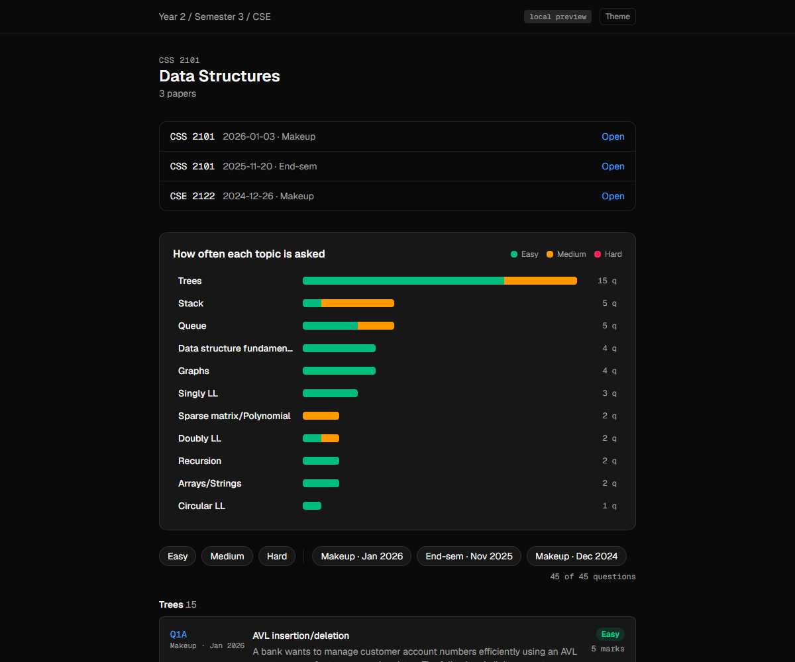
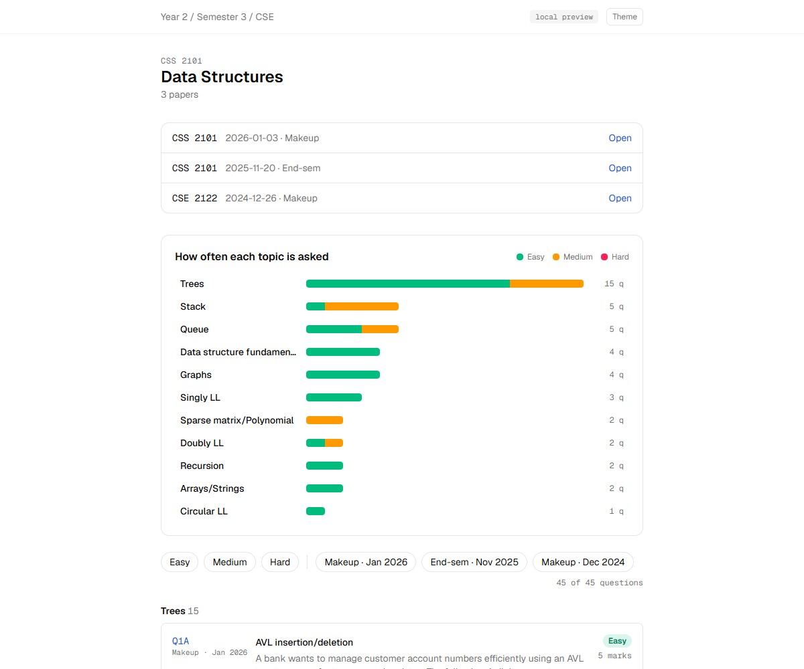
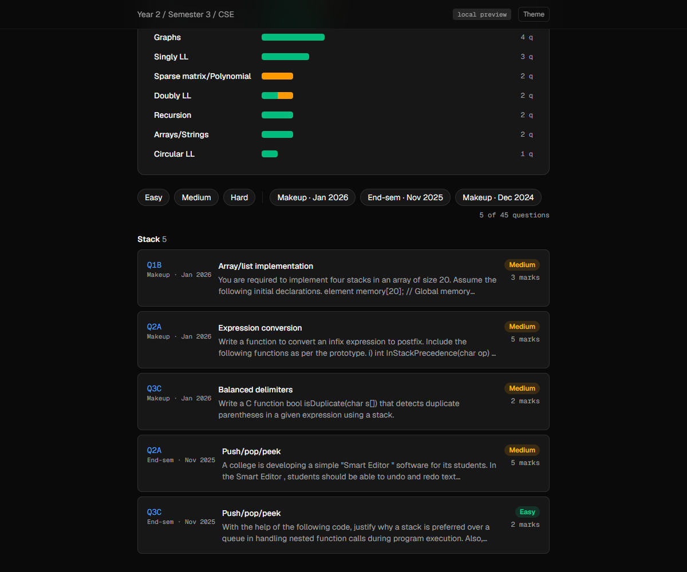
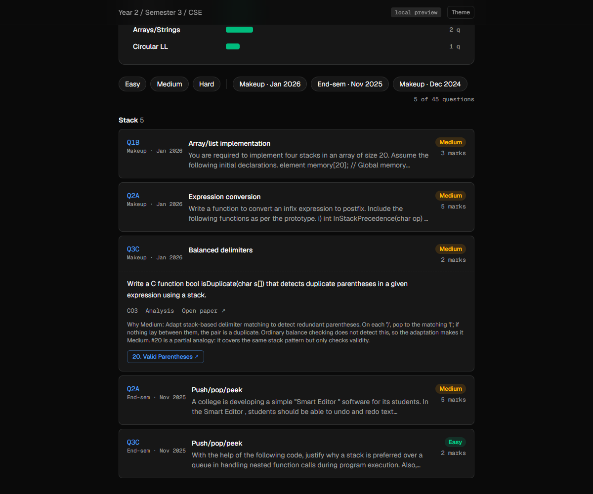
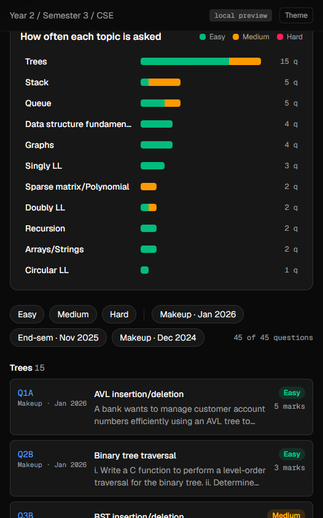

# qp-tagger

Tags every question in MIT Manipal past papers (from [paper.shrit.in](https://paper.shrit.in)) with a
**topic** (Stack, Queue, Singly LL, Doubly LL, Trees, Graphs, ...), a **LeetCode-style difficulty**
(Easy / Medium / Hard, an estimate of the exam task, not an official rating) and **similar LeetCode problems**.

First subject: Data Structures, CSS 2101 (and old code CSE 2122): 3 papers, 45 questions.

## What it looks like

It sits on the subject page, under the existing list of papers.

**Topic map.** How often each topic is asked, split by difficulty. Click a topic to filter.

<table>
  <tr>
    <td></td>
    <td></td>
  </tr>
  <tr><td align="center">Dark (site default)</td><td align="center">Light</td></tr>
</table>

**Filter by topic, difficulty or paper.** Here only the Stack questions are shown.



**Open a question** to read the full text, why it got its difficulty, and similar LeetCode problems.



<table>
  <tr>
    <td width="300"></td>
    <td><b>On phones</b> the topic bars and filter chips wrap to fit the screen.</td>
  </tr>
</table>

## Add it to paper.shrit.in with Claude Code

Paste this into Claude Code from inside the site's repo:

```
Clone https://github.com/Shanmuud/prshrit into a temp folder and follow its MERGE.md to add the
question-map feature to this site. Copy only site/features/question-map/, add the two marked lines to
the subject page (/browse/.../subject/<code>), map any Tailwind token names that differ here, and
change nothing else. Then run typecheck + lint and confirm the CSS 2101 subject page shows the map
in light and dark mode, and that untagged subjects look unchanged.
```

## Preview it

```
cd site
npm install
npm run dev
```
Open http://localhost:3000. It shows the CSS 2101 subject page with the question map under the paper list.

## For the site author: merging

The feature is one self-contained folder, `site/features/question-map/`, written for the same stack as
paper.shrit.in (Next.js App Router, Tailwind, shadcn tokens). Copy it in and add two lines to the
subject page. **`MERGE.md` has a ready-to-paste prompt for Claude Code.** Your site's code never
needs to come into this repo.

## Pipeline (to add more subjects)

```
python scrape.py "<subject page url>"   # PDFs -> data/pdfs/, data/papers.json
python extract.py                       # -> data/questions.json  (pypdf layout mode)
python tag.py                           # -> data/tagged.json     (claude -p + RUBRIC.md)
python export.py "CSS 2101"             # -> site/features/question-map/data/ + export/
python build_page.py                    # -> web/index.html       (standalone preview page)
```

- Questions that are images in the PDF are typed in by hand in `data/overrides.json`.
- `RUBRIC.md` holds the topic taxonomy, difficulty rules and the LeetCode catalogue the tagger may use.

## What's not in this repo
The PDFs themselves (`data/pdfs/`) are not committed. They belong to the archive; `scrape.py` re-downloads them.
